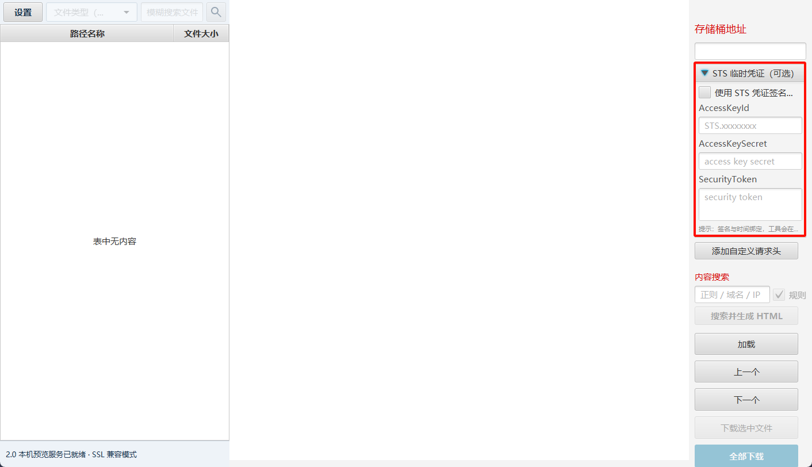
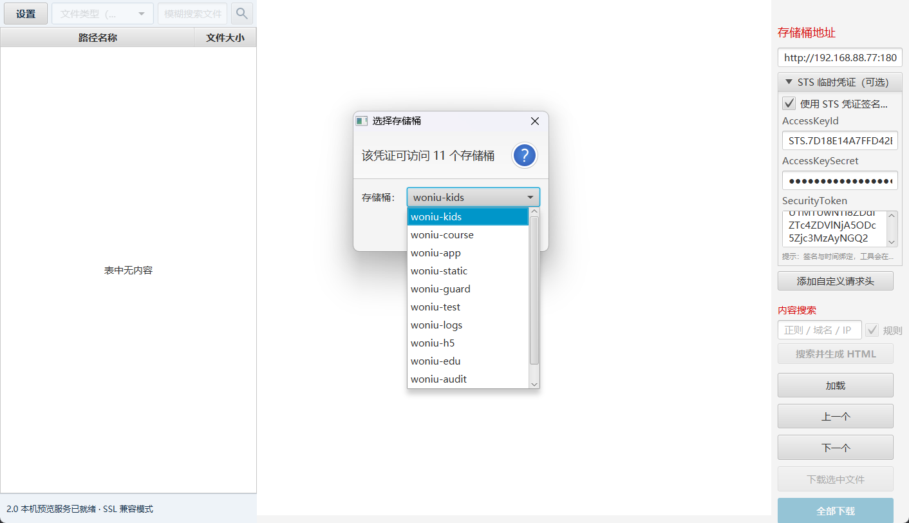
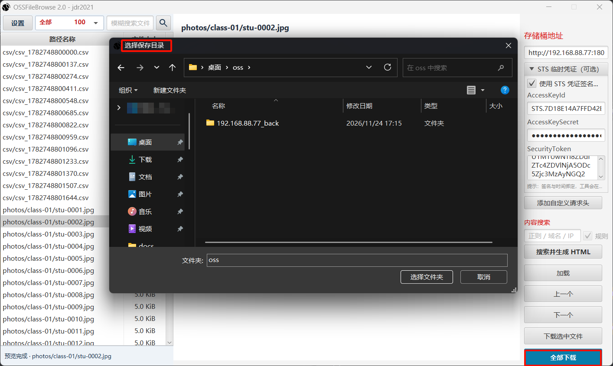
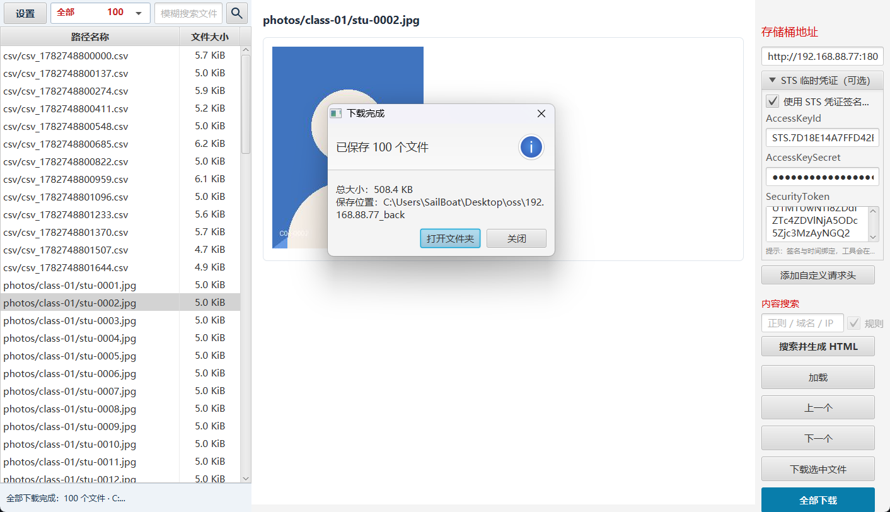

# STS 临时凭证支持

本分支为 OSSFileBrowse 增加了阿里云 **STS 临时凭证（Security Token Service）** 支持。
未勾选 STS 时，行为与原有版本完全一致。

---

## 背景

原版的请求头是「一次性快照」：

```java
Map<String, String> headers = snapshotCustomRequestHeaders();  // 取一次
HttpUtils.httpGet(url, headers);                               // 反复复用
```

而 OSS V1 签名与 `Date` 头绑定，每次请求都必须用当前时间重算：

```text
StringToSign = GET\n\n\n<Date>\n
               x-oss-security-token:<TOKEN>\n
               /<bucket>/<key>
Signature    = Base64(HMAC-SHA1(access_key, StringToSign))
```

复用旧头会导致第二页起返回 `SignatureDoesNotMatch`。
因此本分支引入了「按请求生成请求头」的机制。

---

## 新增能力

### 1. STS 凭证面板

右侧「存储桶地址」下方新增可折叠面板，勾选后填入三要素即可启用。



### 2. 服务端点：ListBuckets 后选桶

地址填 `https://oss-cn-hangzhou.aliyuncs.com/` 或 `/oss/`（无桶名）时，
工具先调用 **ListBuckets**，再弹窗让你选择要浏览的存储桶。



### 3. 两种寻址方式都支持

```text
路径式：      https://endpoint/bucket/key
虚拟主机式：  https://bucket.endpoint/key
```

工具会自动从 URL 推断桶名与对象 key，无需手工拆分。

### 4. 动态签名覆盖所有请求

| 功能 | 说明 |
|---|---|
| 列桶首屏 | 每次请求现签 |
| 翻页列举 | 每页重新签名 |
| 单文件预览 | 代理转发时现签 |
| Range 分段读取 | 每次转发现签 |
| 压缩包内条目 | 同上 |
| 批量下载 | 每个对象现签 |
| 内容搜索 | 每个目标对象现签 |

### 5. 中文 / 特殊字符文件名

签名使用**解码后的原始 key**，URL 传输时才编码：

```java
String path = objectUri.getPath();   // 而非 getRawPath()
```

否则 `中文.pptx` 这类文件名会因签名不匹配而返回 403。

### 6. 下载完成提示

「下载选中文件」完成后弹出对话框，显示文件名、大小、保存位置，
并提供「打开所在文件夹」按钮（Windows 资源管理器 / macOS Finder / Linux 文件管理器）。

### 7. 批量下载选择目录

「全部下载」先弹出目录选择框，完成后汇总显示文件数量、总大小与保存路径。





---

## 使用方式

1. 在「存储桶地址」填入带桶名的 URL，或填服务端点后由工具弹窗选桶：

```text
https://bucket.oss-cn-hangzhou.aliyuncs.com/
https://oss-cn-hangzhou.aliyuncs.com/oss/bucket
https://oss-cn-hangzhou.aliyuncs.com/
```

2. 展开「STS 临时凭证（可选）」，勾选启用

3. 填写三要素

| 字段 | 来源 |
|---|---|
| AccessKeyId | STS 返回的 `AccessKeyId`（形如 `STS.xxx`） |
| AccessKeySecret | STS 返回的 `AccessKeySecret` |
| SecurityToken | STS 返回的 `SecurityToken` |

4. 点「加载」

---

## 兼容性

签名算法为 **OSS V1（HMAC-SHA1）**，适用于：

| 存储 | 兼容 | 备注 |
|---|---|---|
| 阿里云 OSS | ✅ | 原生 |
| MinIO | ✅ | 默认支持 OSS V1 |
| Ceph RGW | ✅ | S3/OSS 双协议 |
| 其他 S3 兼容网关 | ✅ | 需实现 OSS V1 签名 |
| AWS S3 | ❌ | 使用 SigV4 |

---

## 实现说明

### 新增文件

`utils/StsSigner.java` — OSS V1 签名器

```java
public Map<String, String> signGet(String bucket, String key) {
    String date = gmtNow();
    String resource = "/" + bucket + "/" + (key == null ? "" : key);
    String stringToSign = "GET\n\n\n" + date + "\n"
            + "x-oss-security-token:" + securityToken + "\n"
            + resource;
    // Date 与签名一并返回，调用方直接放进请求头
}
```

### 修改点

| 文件 | 改动 |
|---|---|
| `bucket/BucketClient.java` | 新增 `HeaderProvider` 接口；`loadAll` 每页重新取头 |
| `preview/http/PreviewHttpServer.java` | 新增 `RemoteHeaderProvider`；代理转发时动态取头 |
| `controller/mainController.java` | STS 状态管理、UI 读取、预览/下载接入 |
| `resources/fxml/main.fxml` | 新增「STS 临时凭证」面板 |
| `utils/HttpUtils.java` | 无改动（沿用原有 GET 实现） |

### 向后兼容

```java
if (activeStsSigner == null) {
    return activeRequestHeaders;   // 原有静态头逻辑，未改动
}
```

`RemoteHeaderProvider` 为 `null` 时，代理直接使用注册时的静态头。

---

## 注意事项

- **凭据有效期**：STS 通常 1 小时，过期需重新获取并填入
- **时钟偏差**：本机时间与 OSS 服务器相差超过 15 分钟会返回 `RequestTimeTooSkewed`
- **kkFileView 外部预览**：该模式由远端服务直接访问对象 URL，STS 签名无法传递；
  工具内置预览不受影响
- **HTTPS 自签证书**：可在 `config.properties` 中设置 `ignore.ssl=true`
